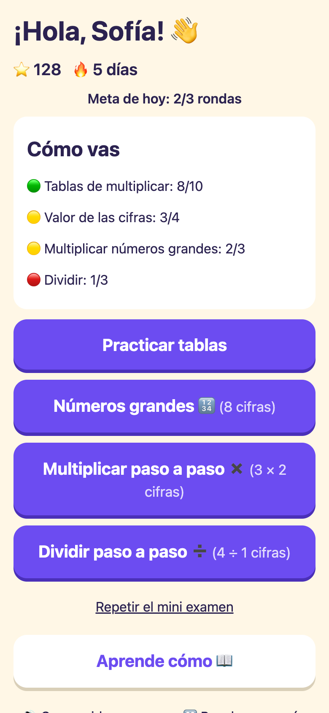
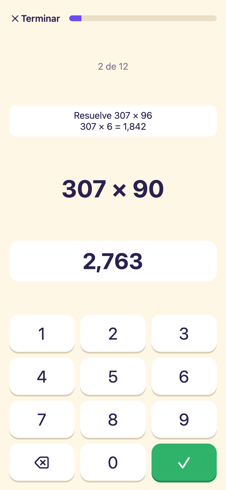
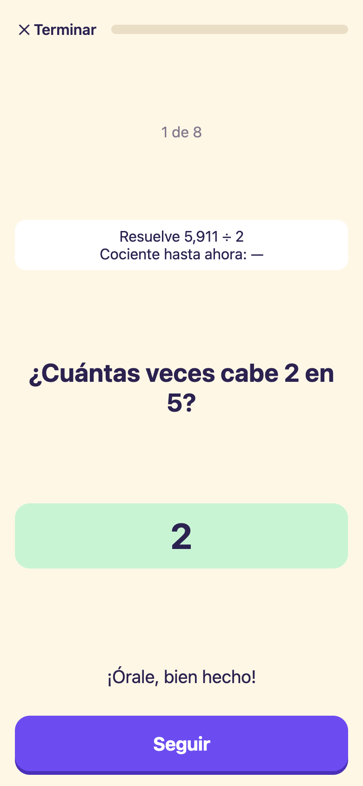
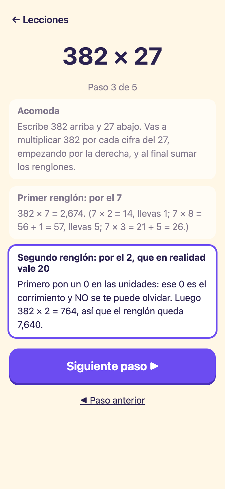
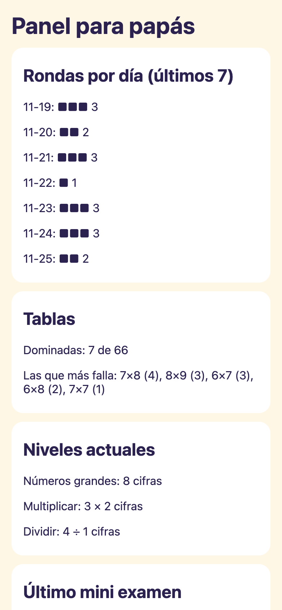

# 🧮 Retos de Mates

App web para que niñas y niños de primaria practiquen matemáticas **un ratito cada día**: tablas de multiplicar, números grandes, multiplicaciones y divisiones largas paso a paso. Se adapta al nivel de cada quien, explica con lecciones guiadas y le da a mamá o papá un panel para ver cómo va.

Funciona en el navegador y se puede **instalar en el celular o la tablet** como una app (PWA), incluso sin internet.

<p align="center">
  
  
  
</p>
<p align="center">
  
  
</p>

## ✨ Qué hace

| Modo | De qué se trata |
|---|---|
| **Mini examen** | 20 preguntas al empezar para ver en qué tema necesita ayuda. Da un semáforo 🟢🟡🔴 por tema y fija el nivel inicial. |
| **Practicar tablas** | Tablas del 2 al 12. Las que falla salen más seguido y las que ya domina se van espaciando. |
| **Números grandes 🔢** | Valor posicional, escribir números con cifras, comparar cuál es mayor y multiplicar/dividir entre 10, 100 y 1,000. De 6 a 15 cifras. |
| **Multiplicar paso a paso ✖️** | Multiplicaciones de varias cifras divididas en productos parciales (incluido el famoso "corrimiento") y la suma final. |
| **Dividir paso a paso ➗** | División larga guiada: "¿cuántas veces cabe?", resta, baja la siguiente cifra… hasta el residuo. |
| **Aprende cómo 📖** | 9 lecciones explicadas paso a paso: multiplicar (simple, mediana, grande, con decimales) y dividir (simple, mediana, grande, con decimales en el cociente y entre un decimal). |
| **Panel para papás 👨‍👩‍👧** | Rondas por día de la última semana, tablas dominadas, las que más falla y el nivel actual de cada tema. |

Además:

- ⭐ **Estrellas y racha de días** 🔥 para motivar sin presionar.
- 🎯 **Meta diaria de 3 rondas** para que la sesión tenga un final claro.
- 📈 **Niveles automáticos**: con 9 o más de 10 aciertos sube de nivel; con 5 o menos baja uno para reforzar.
- 🔊 **Sonidos suaves** que se pueden apagar.
- 🇲🇽 Textos en español de México, con mensajes de ánimo ("¡Órale, bien hecho!").

## 🔒 Privacidad

No hay cuentas, servidor, anuncios ni rastreo. Todo el progreso se guarda **solo en el dispositivo** (`localStorage` del navegador). Si se borran los datos del navegador, se pierde el progreso.

## 🚀 Cómo correrla

Necesitas [Node.js](https://nodejs.org) 20.19 o más reciente (o 22.12+).

```bash
git clone https://github.com/miguelquiroz/Retos-de-mates.git
cd Retos-de-mates/app
npm install
npm run dev
```

Abre la dirección que aparece en la terminal (normalmente http://localhost:5173). Para probarla en el celular dentro de la misma red, usa `npm run dev -- --host`.

### Scripts

Se corren dentro de la carpeta `app/`:

| Comando | Qué hace |
|---|---|
| `npm run dev` | Servidor de desarrollo con recarga automática |
| `npm run build` | Revisa tipos y genera la versión final en `app/dist/` |
| `npm run preview` | Sirve localmente la versión generada en `dist/` |
| `npm test` | Corre las pruebas (Vitest) |
| `npm run lint` | Revisa el código con oxlint |

## 📲 Publicarla e instalarla

`npm run build` genera un sitio estático en `app/dist/` que se puede subir a cualquier hosting estático (Azure Static Web Apps, GitHub Pages, Netlify, Vercel…). El archivo `app/public/staticwebapp.config.json` ya trae la configuración de caché para Azure Static Web Apps.

Una vez publicada, se instala desde el navegador:

- **iPhone / iPad (Safari):** Compartir → *Agregar a pantalla de inicio*.
- **Android (Chrome):** menú ⋮ → *Instalar app*.

## 🛠️ Cómo está hecha

- [React](https://react.dev) 19 + [TypeScript](https://www.typescriptlang.org)
- [Vite](https://vite.dev) + [vite-plugin-pwa](https://vite-pwa-org.netlify.app) (funciona sin conexión)
- [Vitest](https://vitest.dev) para las pruebas
- Sonidos generados con Web Audio (sin archivos de audio)
- Los números grandes se manejan con `BigInt` para no perder precisión con 15 cifras

```
app/
├── public/            # iconos y configuración del hosting
└── src/
    ├── App.tsx        # pantallas: inicio, examen, práctica y resultados
    ├── Aprende.tsx    # lecciones paso a paso
    ├── Panel.tsx      # panel para papás
    ├── logic.ts       # generación de preguntas, niveles y repaso espaciado
    ├── lessons.ts     # contenido de las lecciones
    ├── sound.ts       # efectos de sonido
    └── *.test.ts      # pruebas de la lógica y de las cuentas de las lecciones
```

### El repaso de las tablas

Las tablas usan **cajas de Leitner**: cada multiplicación vive en una caja del 0 (nueva o fallada) al 4 (dominada). Acertar la sube una caja y fallar la regresa a la 0. Al elegir la siguiente pregunta, las cajas bajas tienen mucha más probabilidad de salir, así que se practica más lo que cuesta y menos lo que ya se sabe.

## 🤝 Contribuir

¡Las ideas y mejoras son bienvenidas! Abre un *issue* para proponer algo o manda un *pull request*. Antes de enviarlo, corre `npm test` y `npm run lint` dentro de `app/`.

## 📄 Licencia

[MIT](LICENSE) © 2026 Miguel Quiroz
